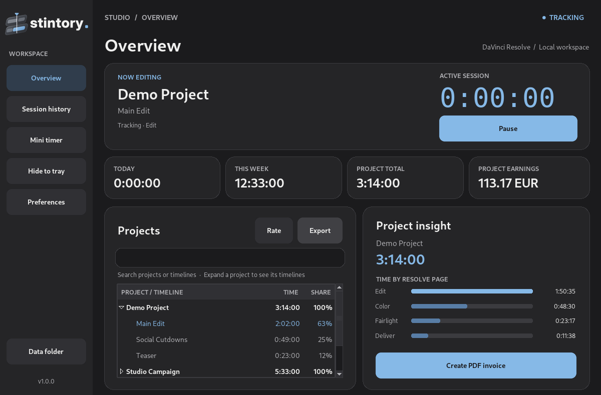

<div align="center">
  
  <p>Automatic time tracking for DaVinci Resolve Studio. Track projects and timelines, analyze your workflow, and create professional invoices. Free, open source, and privacy-friendly.</p>
  <p><strong>Windows · macOS · MIT · v1.0.0 Beta</strong></p>
</div>


## Download Stintory

**Version 1.0.0 — Public Beta**

| Platform | Linked | Resident |
| :--- | :--- | :--- |
| **Windows** | [](https://github.com/benovidla/stintory/releases/download/v1.0.0-beta.1/Stintory-1.0.0-Windows-linked.zip) | [](https://github.com/benovidla/stintory/releases/download/v1.0.0-beta.1/Stintory-1.0.0-Windows-resident.zip) |
| **macOS** | [](https://github.com/benovidla/stintory/releases/download/v1.0.0-beta.1/Stintory-1.0.0-macOS-linked.zip) | [](https://github.com/benovidla/stintory/releases/download/v1.0.0-beta.1/Stintory-1.0.0-macOS-resident.zip) |

- **Linked:** Starts alongside DaVinci Resolve through the configured shortcut or launcher.
- **Resident:** Runs in the background and waits for Resolve activity.

Windows Linked is the recommended beta edition. Windows Resident and both macOS editions are experimental.

Choose **one edition** for your operating system. These ZIP files contain source-based installers, not signed standalone executables.

**Requirements:** DaVinci Resolve Studio with local scripting enabled and Python 3.12.

[Installation guide](#install-from-source-recommended-for-this-beta) · [All releases](https://github.com/benovidla/stintory/releases) · [SHA-256 checksums](https://github.com/benovidla/stintory/releases/download/v1.0.0-beta.1/Stintory-1.0.0-SHA256.txt)

---



> Dashboard preview from 1.0.0 with synthetic demo data.

## Why Stintory?

Spend your time editing, not managing timers. Stintory records work automatically when your Resolve project is active and breaks it down by timeline and Resolve page. Review the numbers, set your rates and export a professional invoice when the work is done.

### Features

- Automatic project and timeline tracking; project totals include unassigned time. The timer freezes when Resolve reports no active editing page. On Windows a conservative foreground-window fallback may detect Project Manager even if the API reports a stale page. No inferred cross-project time reassignment.
- Live timer, compact window, history, manual entries, project hourly rates.
- Idle detection (5 minutes by default; configurable 0–240), playback/render awareness, active-app tracking.
- Crash recovery checkpoints, independent Resolve process detection, isolated scripting helper with automatic reconnection even while the dashboard is hidden.
- Nine color palettes, including the Steel default, rounded dashboard cards, native keyboard-accessible rounded buttons and resolution-specific blue/gray branding. Optional notification animation.
- 20 immediately switchable UI languages ordered approximately by total speakers among the selected languages: English, Simplified Chinese, Hindi, Spanish, Arabic, French, Bengali, Portuguese, Indonesian, Urdu, Russian, German, Japanese, Vietnamese, Turkish, Korean, Italian, Polish, Czech and Slovak. Choose a separate language for PDF invoices.
- 53 billing currencies, shown with ISO codes and symbols. Automatic language/locale suggestion or a persistent manual override; remembers hourly and per-project rates separately for each currency.
- CSV and HTML timesheet export, PDF invoice with optional billing period, tax and payment information.
- Data stored locally; no account, analytics, subscription or cloud service required.

## Compatibility & tested editions

**Windows Linked is the primary, user-tested edition.** The project maintainer reported successful installation, automatic launch with DaVinci Resolve Studio 21 and project/timeline tracking on their own Windows PC during private development. This is user-reported hands-on testing, not a complete certification or a fresh native test of 1.0.0.

| Edition | Real Resolve testing | Status |
| --- | --- | --- |
| Windows Linked | Hands-on testing reported during development / Studio 21; current release retest pending | Recommended beta |
| Windows Resident | Not yet reported | Experimental |
| macOS Linked | Not yet reported | Experimental |
| macOS Resident | Not yet reported | Experimental |

Automated tests use simulated API responses; GitHub runner tests do not include the proprietary Resolve application. Stintory uses checks that detect scripting capabilities instead of enforcing a fixed Resolve version. It reads the locally installed API, reports the detected version in local diagnostics and pauses billing if required calls become unavailable or an unknown editing page appears. Optional timecode/render detection may degrade gracefully. Future Resolve versions are **not guaranteed compatible**. Consult [compatibility](docs/COMPATIBILITY.md) and [testing](docs/TESTING.md) before upgrading.

## Choose how it runs

| Platform | Linked mode | Resident mode |
| --- | --- | --- |
| Windows | `setup_linked.bat` links the desktop shortcut and registers a periodic fallback | `setup_resident.bat` enables per-user login startup |
| macOS | `setup_linked.command` creates a Resolve + Stintory launcher app | `setup_resident.command` enables per-user LaunchAgent |

These are two launch profiles of the same application. Install **one** profile per OS, not both. They share the same local settings and history. Quit Stintory before switching modes. Windows Linked mode modifies the desktop shortcut for immediate launch and registers a per-user Task Scheduler fallback. Every minute a short check detects Resolve in the same Windows session and exits immediately if it is absent. The full tracker is not resident; unmodified shortcuts or taskbar pins can take roughly a minute or longer under scheduler delays. Time before detection is not retroactively billed. Manually quitting Stintory while Resolve remains open will allow the fallback to restart it. Use `DISABLE-LINKED-CHECK.bat` to opt out of periodic checks and keep shortcut-only launch. No audit policy, system files or Resolve binary are modified. macOS Linked mode remains launcher-only. Resident mode remains active after Resolve quits and waits for its next project. Linked mode may take up to two minutes to give up if Resolve fails to start. Open Stintory directly to review history; it attaches automatically if Resolve starts.

## Install from source (recommended for this beta)

### Prerequisites

- DaVinci Resolve **Studio**, with Preferences → System → General → External scripting using → Local enabled, followed by a Resolve restart. Resolve's scripting module and native library must match the architecture of the Python interpreter.
- Python 3.12 from python.org (including Tkinter and pip). Windows: add Python to PATH. macOS: use the matching arm64 or x86_64 interpreter, not a mismatched Rosetta interpreter.
- Internet connection for the initial installation of dependencies only.

### Windows

1. Quit older tracker instances and Resolve. Back up `%APPDATA%\ResolveEditTracker` if upgrading.
2. Extract the entire archive to a stable path (e.g. `C:\Apps\Stintory`), not a temporary folder. Run the desired `setup_*.bat`. If Linked setup fails, use `REPAIR-LINKED.bat` and inspect `setup-linked.log`.
3. For linked mode, launch from the modified DaVinci Resolve desktop icon for immediate startup; other launch paths use the fallback check. For resident mode, launch Resolve normally and open the Stintory shortcut to see its panel. A backup of the original shortcut is kept if one existed.
4. To disable auto-start and restore the linked shortcut use `disable_auto.bat` after quitting the tracker. `review_history.bat` opens the dashboard even without Resolve.

### macOS (experimental)

1. Quit older instances and extract the full archive to a stable folder (e.g. `~/Applications/Stintory-source`).
2. Run the desired `.command` script. In Terminal, if needed: `cd /path/to/Stintory-source` and `bash setup_linked.command` (or `bash setup_resident.command`). Use `STINTORY_PYTHON=/path/to/python3.12` if needed.
3. Linked mode creates `~/Applications/DaVinci Resolve + Stintory.app`. Open this launcher (drag it into the Dock if desired), not the original Resolve icon. The signed Resolve bundle is never altered. Resident mode starts a user LaunchAgent and creates `~/Applications/Stintory.app` to open the panel.
4. `disable_login.command` unloads the LaunchAgent. `review_history.command` opens the dashboard even without Resolve. If macOS blocks an unsigned launcher, inspect the source and use Apple's approved per-app Open flow if you trust it; do not disable Gatekeeper globally.

Mac native idle/foreground detection uses Quartz and NSWorkspace; installed menu-bar integration uses pystray. If the icon is unavailable the app opens its panel; reopening the launcher opens the existing instance. Some native interactions are not yet verified. See `docs/TESTING.md`.

## Local data & languages

Upgrading from earlier development builds: close both programs, replace the source files in the same stable directory, then rerun the chosen installer. The Windows data directory remains unchanged. Installers remove known legacy startup registrations; the macOS installer moves the earlier data directory only if the new one does not exist. Back up your data and remove obsolete desktop/Dock shortcuts after confirming the new version. Existing manually selected themes are preserved; select Steel for the new gray/blue theme. Old desktop shortcuts or Dock pins may be removed manually after confirming the new one works.

- Windows: `%APPDATA%\ResolveEditTracker` (preserves earlier history).
- macOS: `~/Library/Application Support/Stintory`.
- `sessions.json`, `current.json`, `settings.json` and local debug logs. Close Stintory before copying or restoring data. Demo uses an isolated temporary folder.
- Preferences → Appearance → Language: changes apply immediately. Set Invoice language separately or choose it in the export dialog. Translations are beta quality and need native-speaker review. Arabic and Urdu do not yet have fully mirrored UI layouts. Core UI is localized; some low-level messages, theme names, Resolve page names, and CSV/HTML schema remain English. The default names and project/timeline names are never translated automatically.
- Billing: Settings → Billing → Currency. Automatic uses the interface language and a compatible system locale when available. Existing installations retain their previous currency in manual mode until Automatic is selected. First use of a different currency starts at a zero hourly rate; set your own rate. Rates are remembered per currency; a running session keeps its original currency/rate until it ends. No exchange-rate service or automatic currency conversion.
- Invoice export uses saved sessions in a selected project and currency; optional period filters use each session's local start date, without prorating across midnight. By default only sessions in the selected currency are included; other currency amounts are not added together. Enter an optional invoice hourly rate to reprice all saved hours in the selected period, without altering history. Invoice language is independent. Tax and totals use the selected currency minor units. Check invoice details and local tax requirements before sending. No automatic invoice numbering or paid/unpaid ledger. PDF export uses local fonts with glyph-coverage and embedding-permission flag checks. Use only fonts you are authorized to use for client documents. Complex scripts require Pillow with Raqm support and a suitable installed font; these passages are rendered at 288 dpi and may not be selectable. If a font or shaping engine is missing, export reports an error rather than writing broken text.

## Build & test

Source installers are the supported distribution format of this preview. The tracker uses capability-based API checks, source publication safeguards, tray hiding, on-demand review, Project Manager pause, Linked launch, multi-currency billing, and atomic history saves. Unreadable history is not overwritten. Back up your data before upgrading. A corrupt checkpoint is quarantined for inspection. To build standalone native bundles on your own OS, use `build_exe.bat` or `bash build_mac.command`. The Windows build includes a separate `StintoryProbe.exe`; keep the whole `dist/Stintory` directory intact. Mac builds create an unsigned/not notarized `.app` for local testing. Use explicit `--resident` or `--with-resolve --wait-resolve` flags for built executables; source installers handle login and shortcut integration automatically. GitHub Actions includes test and optional native-build workflows. Native builds must be tested and signed/notarized before being advertised as stable downloads.

```sh
python -m pip install -r requirements.txt
python run_tracker.py --simulate --no-tray
python scripts/test_all.py
```

Linux CI requires Xvfb, Tk and suitable system fonts; Linux itself is not a supported Resolve tracking platform. Read the [release notes](RELEASE_NOTES.md) and [test results](docs/TEST-RESULTS.md). See [contributing](CONTRIBUTING.md), [architecture](docs/ARCHITECTURE.md), [testing](docs/TESTING.md) and [credits](CREDITS.md).

## On-demand review and tray
Open the installed Stintory shortcut (or `run.bat` / `review_history.command`) to review history and export invoices without starting Resolve. In Linked mode it stays open until you close it; if Resolve starts while reviewing, tracking attaches automatically and the tracker exits after Resolve closes. Hide to tray is available in the dashboard and mini timer; while Resolve is running, tracking continues. Reopen from the tray/menu bar or the Stintory shortcut. If no tray is available, normal taskbar minimization is used. Closing a manual Linked review before Resolve starts exits Stintory. Resident mode keeps its usual login behavior.

## License

MIT for project code, subject to third-party terms. See [LICENSE](LICENSE), [CREDITS.md](CREDITS.md) and [THIRD_PARTY_NOTICES.md](THIRD_PARTY_NOTICES.md). Stintory is an independent community project, not affiliated with or endorsed by Blackmagic Design. DaVinci Resolve is a trademark of Blackmagic Design. The project does not bundle DaVinci Resolve, its scripting libraries, or commercial tracker assets.

Source ZIPs do not include the proprietary Resolve SDK, Python runtime or dependency wheels. Native binaries are for private development only until dependency notices, redistribution obligations and signing are reviewed. See [brand assets](docs/BRAND.md) for design and typography details.
